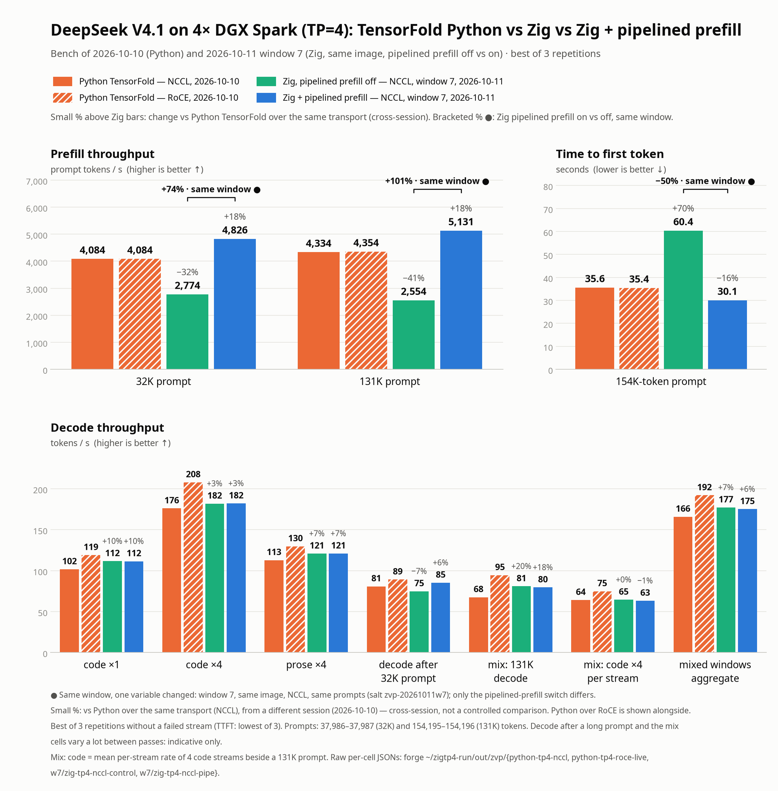

# q28-v2: CUDA Zig vs Python

Measured on two DGX Spark nodes (GB10, 128 GB each), TP=2 over RoCE, q28-v2 EXL3 2.8 bpw, 2026-10-09/10.
Zig runs the [serving profile](../config/prod-zig.env.example) (4K prefill, the engine's own boot calibration) on
the [exported engine source](../engine/zig/SOURCE-EXPORT.md). Python is the production Python serving path at the
time (engine `8474f31`, its own boot calibration), measured fresh the same night on the same pair, with the same pack
and the same bench scripts.

## Method

Each engine: a fresh boot, one cold repetition (no warm-up), three warm repetitions of every short cell, then three
passes of the long, mixed and mixed-window cells, then two salted long passes (byte-identical prompts for both
engines, so each long prompt is a fresh prefill). The headline is **best of 3** warm repetitions for both engines,
with medians beside it. Each warm repetition starts with an untimed warm-up of its cell.

Decode tok/s unless marked prompt. ×4 figures are the aggregate of four concurrent streams. T0 is greedy, T0.7 is
sampled (top-k 20). Code and prose are the two short workloads. Prompt throughput is prompt tokens divided by time to
first token. The 32K / 131K labels are the workload sizes before prompt encoding; the prompts are 37,974 and
154,183 tokens.

## Short decode

| Cell | Zig best / median | Python best / median | Best Δ | Median Δ | First rep Δ | Cold: Zig / Python (Δ) |
| --- | ---: | ---: | ---: | ---: | ---: | ---: |
| code T0 ×1 | 90.3 / 90.0 | 88.0 / 86.5 | +2.6 % | +4.1 % | +7.2 % | 88.4 / 84.6 (+4.4 %) |
| code T0 ×4 | 156.4 / 156.1 | 144.1 / 143.7 | +8.6 % | +8.6 % | +9.8 % | 147.7 / 141.2 (+4.6 %) |
| code T0.7 ×1 | 92.2 / 92.1 | 91.3 / 90.5 | +1.0 % | +1.8 % | +4.0 % | 89.6 / 87.2 (+2.7 %) |
| code T0.7 ×4 | 153.0 / 152.7 | 145.0 / 143.6 | +5.6 % | +6.3 % | +4.8 % | 147.4 / 140.2 (+5.2 %) |
| prose T0 ×1 | 54.7 / 54.6 | 53.8 / 53.7 | +1.7 % | +1.7 % | +6.2 % | 54.1 / 51.3 (+5.5 %) |
| prose T0 ×4 | 104.7 / 103.8 | 98.2 / 98.0 | +6.6 % | +6.0 % | +6.6 % | 99.2 / 95.7 (+3.7 %) |
| prose T0.7 ×1 | 50.6 / 50.5 | 49.6 / 49.2 | +2.1 % | +2.5 % | +5.6 % | 49.3 / 46.6 (+5.8 %) |
| prose T0.7 ×4 | 103.3 / 102.5 | 97.9 / 97.8 | +5.6 % | +4.9 % | +7.1 % | 101.6 / 94.9 (+7.1 %) |

Code ×4 is +5.6 to +8.6 % and code ×1 +1.0 to +2.6 % (best of 3). First warm repetition against Python's first:
+4.0 to +9.8 %. Cold repetition against Python's cold: +2.7 to +7.1 %.

## Long prompts, long decode, mixed load

| Cell | Repetitions | Zig best / median | Python best / median | Best Δ | Median Δ |
| --- | --- | ---: | ---: | ---: | ---: |
| 32K prompt (tok/s) | 3 cold prefills | 2,686.4 / 2,683.7 | 2,440.2 / 2,439.4 | +10.1 % | +10.0 % |
| 131K prompt (tok/s) | 3 cold prefills | 2,496.4 / 2,495.7 | 2,263.5 / 2,261.5 | +10.3 % | +10.4 % |
| Time to first token, 32K / 131K (best, s) | 3 | 14.14 / 61.76 | 15.56 / 68.12 | -9.2 / -9.3 % | |
| 32K decode | 3 | 63.58 / 63.12 | 63.47 / 62.12 | +0.2 % | +1.6 % |
| 131K decode | 3 | 69.26 / 68.65 | 67.04 / 66.55 | +3.3 % | +3.2 % |
| mix: 131K decode beside code ×4 | 3 | 69.58 / 68.55 | 67.39 / 67.04 | +3.2 % | +2.3 % |
| mix: code ×4 aggregate | 3 | 155.92 / 155.76 | 145.10 / 144.88 | +7.5 % | +7.5 % |
| mixed windows: aggregate | 3 | 155.09 / 155.07 | 143.39 / 142.90 | +8.2 % | +8.5 % |
| mixed windows: long stream (tok/s) | 3 | 27.09 / 27.06 | 24.27 / 24.16 | +11.6 % | +12.0 % |

Long decode is near parity at 32K and +3.3 % at 131K. An earlier figure of about +20 % on long decode compared
against a Python run whose first long rounds were slow (cold); it does not hold against a warm, same-night Python run
and is withdrawn. In the mixed-window cell one long stream decodes in the same rounds as three code streams; its
rate counts tokens (`long_live_tok_s`). Earlier versions of the bench reported decode rounds a second under that name.

## Replies

Short-cell replies: 16/16 equal to the reference on both engines. Long replies: the base long passes and both salted
passes give the same reply hashes on Zig and Python. This is parity with this Python reference at these settings,
not a claim about model quality in general.

## Limits

One pair of nodes, one night, three repetitions a cell, no confidence intervals. A later fresh-boot pair with one
warm repetition each gave Zig +3.0 / +3.8 % on code ×1 / ×4, so treat differences of a few percent as indicative.
The final run's raw records are not part of this export; the numbers above are copied from the run log. The files in
[`results/zig-q28-v2`](../results/zig-q28-v2/README.md) hold the earlier 2026-10-09 comparison (single Zig runs, 2K
prefill), which this page replaces.

## Historical vLLM comparison

The [existing Python vs vLLM table](../README.md#historical-29-bpw-results-python-vs-vllm) remains unchanged:
code greedy ×1 41.9–45.0, prose greedy ×1 32.5, aggregate ×1/×2/×4 32.2/46.7/37.6, and cold prefill
8K/32K/64K/128K 1,073/1,075/1,060/1,031 tok/s for vLLM. Those runs use the older 2.9 bpw pack and different
workloads. There is no matched q28-v2 Zig vs vLLM run here, so no new ratio is claimed.

## TP=4: Python vs Zig vs Zig + pipelined prefill (2026-10-11)

DeepSeek V4.1 Flash on four DGX Spark nodes, TP=4, measured with `bench/zig_vs_python.py`. Python is the live
Python TensorFold TP4 engine, benched on 2026-10-10 over NCCL and over RoCE. The Zig series come from one window
(window 7, 2026-10-11): one image over NCCL, booted twice with the same prompts (salt `zvp-20261011w7`). The only
difference between the two boots is the pipelined-prefill switch.

([SVG](img/prefill-pipe-comparison-20261011.svg). Regenerate with
`uv run --with matplotlib python bench/charts/prefill_pipe_comparison.py render`. The data is in
[`bench/charts/data/prefill-pipe-20261011.json`](../bench/charts/data/prefill-pipe-20261011.json), with every value's
source file. Add a series with that script's `add` subcommand.)

| Cell | Python NCCL | Python RoCE | Zig, pipeline off (NCCL) | Zig + pipeline (NCCL) | Pipeline on vs off (same window) | Zig + pipeline vs Python NCCL (cross-session) |
| --- | ---: | ---: | ---: | ---: | ---: | ---: |
| 32K prompt (prompt tok/s) | 4,084.5 | 4,083.6 | 2,774.4 | 4,825.6 | +73.9 % | +18.1 % |
| 131K prompt (prompt tok/s) | 4,333.6 | 4,354.1 | 2,554.5 | 5,131.0 | +100.9 % | +18.4 % |
| Time to first token, 154K-token prompt (s, lower is better) | 35.58 | 35.41 | 60.36 | 30.05 | −50.2 % | −15.5 % |
| code T0 ×1 (tok/s) | 101.7 | 119.1 | 111.6 | 111.5 | −0.1 % | +9.6 % |
| code T0 ×4 (aggregate tok/s) | 176.1 | 207.9 | 181.9 | 182.1 | +0.1 % | +3.4 % |
| prose T0 ×4 (aggregate tok/s) | 112.9 | 129.8 | 120.9 | 121.0 | +0.0 % | +7.1 % |
| decode after the 32K prompt (tok/s) | 80.85 | 89.22 | 74.85 | 85.34 | +14.0 % | +5.6 % |
| mix: 131K decode beside code ×4 (tok/s) | 67.64 | 94.57 | 80.93 | 79.57 | −1.7 % | +17.6 % |
| mix: code ×4, mean per stream (tok/s) | 64.25 | 74.88 | 64.54 | 63.30 | −1.9 % | −1.5 % |
| mixed windows: aggregate (tok/s) | 165.92 | 192.08 | 177.25 | 175.15 | −1.2 % | +5.6 % |

Each value is the best of 3 repetitions without a failed stream; time to first token is the lowest of 3. The data
file also records the median and the repetition count. The 32K / 131K labels are workload sizes; the prompts are
37,986–37,987 and 154,195–154,196 tokens.

- **Controlled:** only the "pipeline on vs off" column. Both boots ran in the same window on the same image, transport
  and prompts, with only the pipelined-prefill switch changed. Prefill gains +74 % at 32K and +101 % at 131K, and
  time to first token on the 154K-token prompt halves. Short decode is unchanged (within ±1 %).
- **Cross-session:** every comparison with Python. The Python runs come from a different session (2026-10-10), so
  more than one variable differs, and these are not controlled comparisons. The percentages compare against Python
  over the same transport (NCCL).
- **Transport matters for Python decode.** Python over RoCE decodes 10–40 % faster than Python over NCCL in these
  cells; on prefill the two transports are within 0.5 %. Zig over RoCE with the pipeline (window 8) is not in this
  chart yet.
- Decode after a long prompt and the mix cells vary a lot between passes. For example, Python over NCCL ran 61–81
  tok/s on decode after the 32K prompt, so treat those cells as indicative only.
- Sources (forge `~/zigtp4-run/out/zvp/`): `python-tp4-nccl/`, `python-tp4-roce-live/`, `w7/zig-tp4-nccl-control/`,
  `w7/zig-tp4-nccl-pipe/` (`long.json`, `warm.json`, `mix.json`, `mixwin.json`). The on/off figures match
  `w7/compare-control-vs-pipe.w7.md`, and the Python NCCL figures match `compare-nccl.w4b.md`. The Python prefill
  figures (4,084 tok/s at 32K, 4,354 at 131K, 35.4–35.6 s time to first token) are these runs' own long cells.
